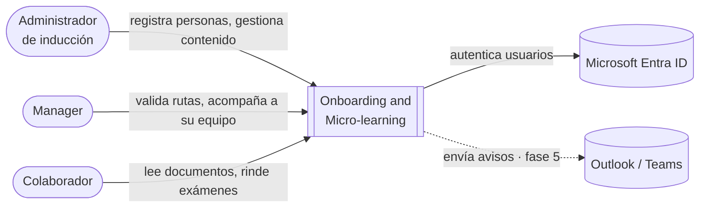
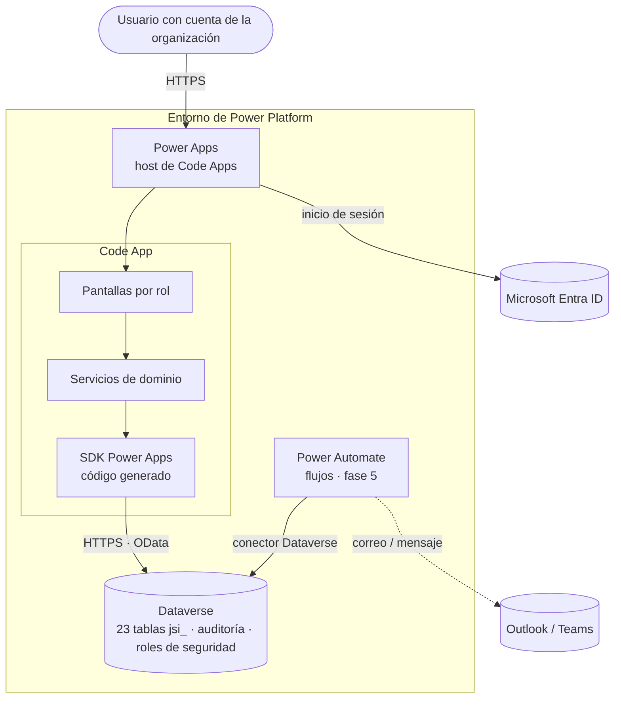
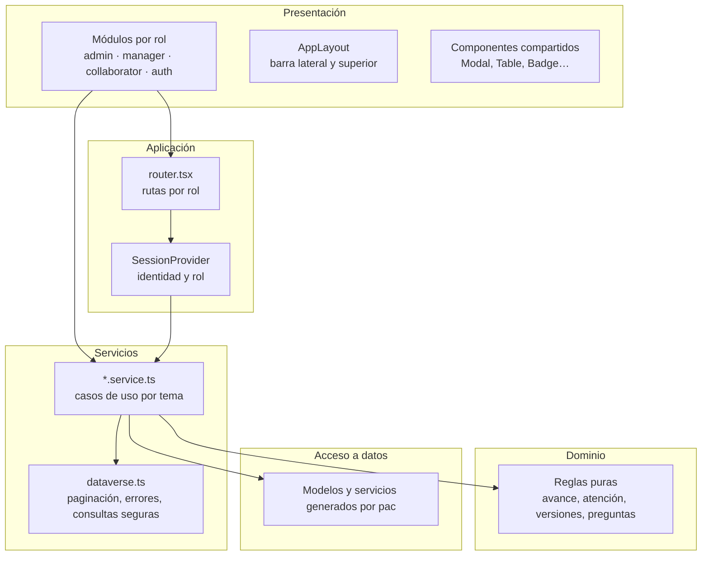
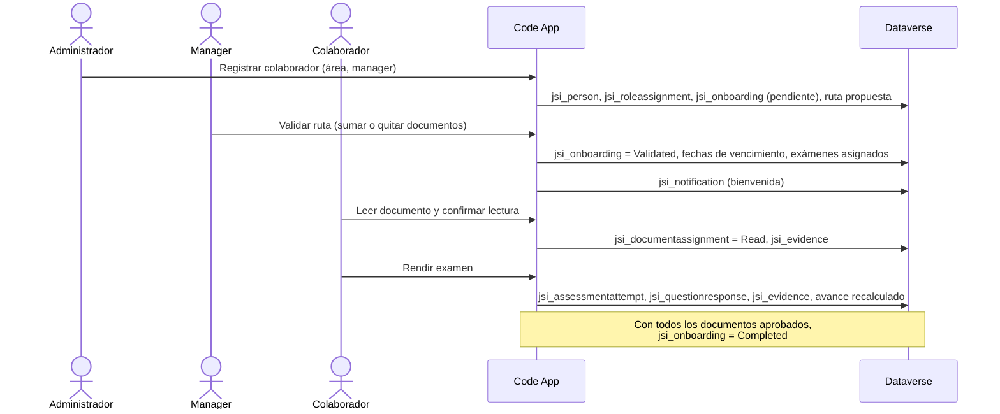

# 02 · Arquitectura

| Campo | Valor |
| --- | --- |
| Sistema | Onboarding and Micro-learning |
| Versión | 0.4.0 |
| Entregable | JLS-ENG-PR01, actividad 7: «Diagramas de Arquitectura» |
| Notación | Modelo C4 (contexto, contenedores, componentes) |

## 1. Diagrama de contexto

Quién usa el sistema y con qué sistemas externos se relaciona.

## 2. Diagrama de contenedores

| Contenedor | Responsabilidad | Tecnología |
| --- | --- | --- |
| Power Apps (host) | Autenticar, servir la app, darle el contexto del usuario | Power Apps Code Apps |
| Code App | Interfaz, reglas del programa, consultas | React 19, TypeScript, Vite |
| Dataverse | Datos, integridad (claves, relaciones `Restrict`), permisos, auditoría | Microsoft Dataverse |
| Power Automate | Procesos sin usuario presente: avisos, recordatorios, recálculos | Flujos en la solución |

## 3. Diagrama de componentes (Code App)

La app está dividida en capas. Cada capa solo usa la de abajo: las pantallas nunca llaman a Dataverse directamente.

| Capa | Carpeta | Regla |
| --- | --- | --- |
| Presentación | `src/modules/<rol>`, `src/layouts`, `src/shared/components` | Muestra datos y valida formularios; no conoce nombres de columnas de Dataverse |
| Aplicación | `src/app` | Rutas y sesión; un rol solo accede a sus rutas |
| Servicios | `src/services` | Traducen entre el dominio y Dataverse; único lugar con nombres `jsi_…` |
| Dominio | `src/shared/domain` | Funciones puras, sin acceso a datos; cubiertas por pruebas unitarias |
| Acceso a datos | `src/generated` | Generado por `pac code add-data-source`; **no se edita a mano** |

## 4. Flujo principal: de registro a inducción completada

## 5. Seguridad en la arquitectura

| Control | Dónde | Detalle |
| --- | --- | --- |
| Autenticación | Power Apps + Entra ID | Nadie abre la app sin cuenta de la organización |
| Identidad en la app | `src/services/identity.service.ts` | Persona = cuenta real; solo sus roles (ver [ADR 0005](../adr/0005-identidad-real-y-simulacion.md)) |
| Autorización en el servidor | Roles de seguridad de Dataverse | Matriz en `dataverse-schema-tool/security-roles.mjs` |
| Transporte | HTTPS (TLS) | Todo el tráfico entre navegador, Power Apps y Dataverse |
| Datos en reposo | Dataverse | Cifrado administrado por Microsoft |
| Integridad | Dataverse | Claves alternativas (correo, código de documento), relaciones `Restrict` |
| Trazabilidad | `jsi_evidence` + auditoría de Dataverse | Evidencia de negocio + registro técnico de cambios (90 días) |

## 6. Decisiones de arquitectura

Las decisiones importantes y sus alternativas están en [`docs/adr`](../adr):

| ADR | Decisión |
| --- | --- |
| [0001](../adr/0001-power-apps-code-apps.md) | Power Apps Code Apps con React en lugar de una app de lienzo |
| [0002](../adr/0002-tabla-propia-jsi-person.md) | Tabla propia `jsi_person` en lugar de `contact` |
| [0003](../adr/0003-esquema-como-codigo.md) | El esquema de Dataverse se define como código |
| [0004](../adr/0004-evidencia-inmutable.md) | Evidencia y preguntas respondidas nunca se modifican |
| [0005](../adr/0005-identidad-real-y-simulacion.md) | Identidad real en producción; simulación solo en desarrollo |

El modelo de datos completo está en [`docs/modelo-entidad-relacion.md`](../modelo-entidad-relacion.md) y su diagrama interactivo en [`docs/modelo-er-grafico.html`](../modelo-er-grafico.html).
