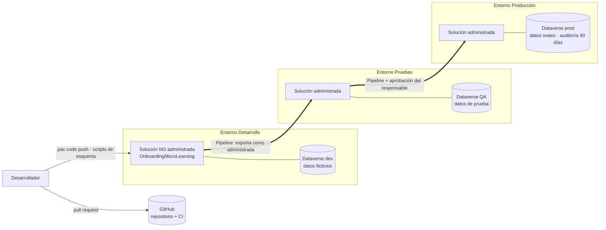

# 03 · Despliegue

| Campo | Valor |
| --- | --- |
| Sistema | Onboarding and Micro-learning |
| Versión | 0.4.0 |
| Entregables | JLS-ENG-PR01, actividad 5 «procedimientos de despliegue», actividad 7 «Diagramas del deployment en el ambiente de producción», actividades 10 a 14 «Despliegue y verificación» |

## 1. Diagrama de despliegue

El sistema se despliega como **una solución de Power Platform** (`OnboardingMicroLearning`) que contiene el esquema de Dataverse, la Code App, los roles de seguridad y los flujos. La solución viaja de un entorno a otro con un pipeline; los **datos no viajan**.



| Elemento | Contenido |
| --- | --- |
| Solución `OnboardingMicroLearning` | 23 tablas `jsi_`, relaciones, claves alternativas, Code App, 3 roles de seguridad, flujos (fase 5), referencias de conexión, variables de entorno |
| Publisher | `jalasoftonboarding`, prefijo `jsi` |
| Código fuente | GitHub; la CI valida cada cambio (ver [12 · Plan de pruebas](12-plan-de-pruebas.md)) |
| Datos | Cada entorno tiene los suyos; los datos base se cargan con `npm run seed` solo en desarrollo y pruebas |

## 2. Procedimiento de despliegue

### 2.1 A desarrollo (cada desarrollador)

```powershell
# Esquema (dentro de dataverse-schema-tool)
npm run dry-run ; npm run create
npm run roles:dry-run ; npm run roles
npm run audit:dry-run ; npm run audit

# App (en la raíz)
npm ci
npm run lint ; npm test ; npm run build
pac code push
```

### 2.2 A pruebas y producción (pipeline)

1. El cambio está unido a `main`, con la CI en verde y aprobado por un compañero.
2. Se sube la versión de la solución (`CONFIG.solutionVersion` en `schema.mjs` y `version` en `package.json`) y se registra en el [CHANGELOG](../../CHANGELOG.md).
3. Se ejecuta el pipeline de Power Platform: exporta la solución de desarrollo como **administrada** y la importa en el entorno destino.
4. En el primer despliegue a un entorno: un administrador activa la auditoría (`npm run audit:org` o el Centro de administración) y asigna los roles de seguridad a los usuarios.
5. Se ejecuta la verificación posterior al despliegue (sección 4).

## 3. Plan de despliegue (plantilla por cada pase)

Completar y aprobar con el Responsable del Proyecto **antes** de cada pase a producción (PR01, actividades 10 y 11).

| Campo | Valor |
| --- | --- |
| Versión a desplegar | `x.y.z` (solución `x.y.z.0`) |
| Fecha y hora | AAAA-MM-DD HH:MM (fuera del horario de uso) |
| Responsable de ejecución | Equipo de ingeniería: nombre |
| Aprobador | Responsable del Proyecto: nombre |
| Contacto de Technological Infrastructure | nombre |
| Cambios incluidos | enlace al CHANGELOG de la versión |
| Cambios de esquema | sí / no; si sí, cuáles y si borran columnas |
| Ventana estimada | 30 minutos |
| Criterio de éxito | Verificación posterior completa sin errores |

### 3.1 Rollback

| Situación | Acción |
| --- | --- |
| La app nueva falla y el esquema no cambió | Reimportar en producción la versión anterior de la solución administrada (el pipeline guarda cada versión) |
| Se agregaron columnas o tablas | Reimportar la versión anterior: las columnas nuevas quedan sin uso y no afectan |
| Se borraron columnas o tablas | **No hay rollback automático.** Por eso un borrado se despliega en dos pases: primero la app deja de usar la columna, después se borra |
| Datos dañados por un error | Revisar el historial de auditoría de Dataverse para identificar y restaurar los valores anteriores |

## 4. Verificación posterior al despliegue

| # | Comprobación | Quién |
| --- | --- | --- |
| 1 | La app abre con una cuenta de cada rol y muestra solo sus perfiles | Equipo de ingeniería |
| 2 | Un Administrador ve el panel y la lista de colaboradores | Usuario clave |
| 3 | Un Colaborador abre un documento de su ruta | Usuario clave |
| 4 | El historial de auditoría registra un cambio de prueba | Equipo de ingeniería |
| 5 | Los flujos de Power Automate corren sin errores (fase 5) | Equipo de ingeniería |
| 6 | Sin errores en la consola del navegador ni en el Centro de administración | Equipo de ingeniería |

Al terminar se registran las lecciones aprendidas (actividad 15) y se actualiza esta documentación si algo cambió (actividad 16).
